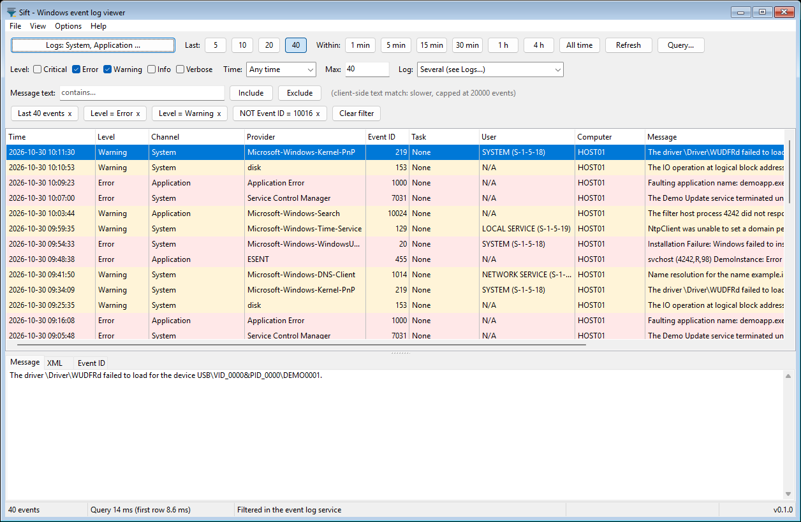

# Sift

A light, fast Windows event log viewer. Every filter compiles to the event log
service's own structured XML query (`<QueryList>` with Select/Suppress), so
Windows does the filtering instead of RAM. Wireshark-style right-click on any
cell: Include or Exclude, then "Add to current filter" or "Set as current
filter". One-click quick buttons for the last 5/10/20/40 events and the last
1 min / 5 min / 15 min / 30 min / 1 h / 4 h. An easy-button toolbar row
(Level boxes, Time, Max, Log) writes into the same filter, so "all errors in
the last hour" or "last 15 System errors" is two clicks.

Phase 1 ships the viewer. The filter engine (SiftCore) has no LCL references so
a read-only stdio MCP server can sit on the same engine later
(see [docs/mcp-plan.md](docs/mcp-plan.md)).

Free to use, by kilrkrow (MIT license with the Commons Clause, see
[LICENSE](LICENSE)). No telemetry, no network calls, nothing written to the
system's logs or channel settings.



## Status

Phase 1, version 0.1.1. Built and tested on Windows 11 only so far; see
[docs/compat.md](docs/compat.md) for which Windows versions it was actually run on.

## Notes for 0.1.1

Security fixes. Filter values (providers, computers, message text, and the
other free-text fields) are validated in one place; a value that contains
both quote styles, a line equal to `'@`, or a control character is rejected
with a visible reason, and a SID that is not `S-1-` plus at least one RID
group is rejected the same way. PowerShell export writes the query XML as a
Base64 blob, not a here-string, so a crafted value cannot break out of the
script. Remote and UNC `file://` paths are rejected at the core: they are
never queried and never written to `sift.ini`. An elevation restart writes
a random exclusive temp file and passes a SHA-256 of its bytes; the elevated
process verifies the hash, loads the filter, and always deletes the file.
`lastN`, `textScanCap`, and `AllTimeRowCap` are clamped to a documented
maximum of 200000 (a JSON file with `"lastN": 2147483647` loads clamped,
not rejected). Both Release exes have ASLR, NX, and a `.reloc` section
(win64 also has high-entropy VA). At start-up, `SetDefaultDllDirectories`
is called through `GetProcAddress` (skipped if the API is missing), and
`version.dll` is loaded only from System32, so a DLL of that name next to
the exe is not used.

There is no tag and no release for this version yet. Authenticode signing,
branch protection, CI, and signed checksums are follow-ups.

## Toolchain

| | Version |
|---|---|
| Lazarus | 4.8 (current stable on lazarus-ide.org, bugfix release of 2026-06-11) |
| Free Pascal | 3.2.2 (bundled with Lazarus 4.8) |
| win32 target | official add-on `lazarus-4.8-fpc-3.2.2-cross-i386-win32-win64.exe` |

Install Lazarus 4.8 for Windows 64-bit from lazarus-ide.org (or
`winget install Lazarus.Lazarus`), plus the official add-on
`lazarus-4.8-fpc-3.2.2-cross-i386-win32-win64.exe` for the 32-bit build. The
commands below assume the default install folder `C:\lazarus`; if `lazbuild`
is on your PATH you can use `lazbuild` instead of `$LB`.

## Build (Windows PowerShell, one command per line)

```powershell
$LB = 'C:\lazarus\lazbuild.exe'
& $LB src\app\sift.lpi --build-mode=Release-win64
& $LB src\app\sift.lpi --build-mode=Release-win32
```

Output: `src\app\bin\x86_64-win64\sift.exe` and `src\app\bin\i386-win32\sift.exe`.
Each is a single exe with no runtime. Sizes at 0.1.1: 3,950,080 bytes (win64)
and 2,967,552 bytes (win32), icon included. Sizes at 0.1.0 (with pieces 8 to
10) were 3,818,496 and 2,791,936.

Every build mode runs `tools\After-Link.ps1` on the linked exe ("execute
after" in `src\app\sift.lpi`). That script removes a residual static
`version.dll` import (the precompiled LCL) and binds it to System32, then
runs `tools\Check-Imports.ps1`. A build fails when the exe has no icon
(RT_GROUP_ICON with its 9 sizes) or no version resource; release builds also
fail on any import that is not on the reviewed Windows 7 allowlist, and on a
PE missing ASLR (DYNAMIC_BASE), NX (NX_COMPAT), a `.reloc` section, or (win64)
HIGH_ENTROPY_VA. (Harness builds check resources only.) If you copy `sift.lpi` under another name,
copy `sift.ico` to the same base name too: Lazarus takes the project icon
from `<project>.ico`. That is how one out-of-tree win64 build lost its icon.

The release exes contain no test code. A separate harness build adds a
headless screenshot / self-test mode (see "Other checks"):

```powershell
& $LB src\app\sift.lpi --build-mode=Harness-win64
& $LB src\app\sift.lpi --build-mode=Harness-win32
```

Output: `src\app\bin\harness-x86_64-win64\sift.exe` and `src\app\bin\harness-i386-win32\sift.exe`.

## Run

```powershell
.\src\app\bin\x86_64-win64\sift.exe
.\src\app\bin\x86_64-win64\sift.exe --tray
.\src\app\bin\x86_64-win64\sift.exe --filter my.siftfilter.json
```

`--tray` starts hidden in the notification area (falls back to a normal window
where there is no notification area, e.g. Server Core).

## Tests (headless, no admin)

```powershell
& $LB tests\siftcoretests.lpi
.\tests\bin\x86_64-win64\siftcoretests.exe
& $LB tests\siftcoretests.lpi --cpu=i386 --os=win32
.\tests\bin\i386-win32\siftcoretests.exe
```

The runner prints PASS, SKIP or FAIL per test and a summary with separate
passed / skipped / failed counts. Tests skip (never pass) when they cannot
apply: the access-denied tests in an elevated session, and the optional
extra fixture when `SIFT_PROBE_EVTX` is not set:

```powershell
$env:SIFT_PROBE_EVTX = 'C:\path\to\some-system-export.evtx'
```

The first run calls `tests\fixtures\Make-Fixtures.ps1`, which exports the last
3000 System and Application events of this machine to `.evtx` fixtures with
`wevtutil epl` (unelevated). Those files are not committed: they hold real
machine events and are regenerated on demand. The equivalence tests compare
Sift's results with `Get-WinEvent` (Windows PowerShell 5.1) on those fixtures,
on the live System log, and by running the exported PowerShell as-is.

Optional, needs admin once: a dedicated `SiftTest` event source with known
events across levels, IDs and 1 min .. 4 h timestamps.

```powershell
powershell -NoProfile -ExecutionPolicy Bypass -File tests\fixtures\Register-SiftTestSource.ps1
powershell -NoProfile -ExecutionPolicy Bypass -File tests\fixtures\Write-SiftTestEvents.ps1 -SpreadMinutes 240
powershell -NoProfile -ExecutionPolicy Bypass -File tests\fixtures\Make-Fixtures.ps1 -Force
```

(The first line must run in an elevated Windows PowerShell. The second writes
the events over 4 hours; leave it running.)

## Other checks

```powershell
powershell -NoProfile -ExecutionPolicy Bypass -File tools\Check-Imports.ps1 -Exe src\app\bin\x86_64-win64\sift.exe
powershell -NoProfile -ExecutionPolicy Bypass -File tools\Check-Imports.ps1 -Exe src\app\bin\i386-win32\sift.exe
& $LB tools\bench\siftbench.lpi
powershell -NoProfile -ExecutionPolicy Bypass -File tools\bench\Run-Benchmarks.ps1 -BuildBigLog
.\src\app\bin\harness-x86_64-win64\sift.exe --screenshots $env:TEMP\sift-shots
.\src\app\bin\harness-x86_64-win64\sift.exe --dump-ui $env:TEMP\sift-ui.txt
.\src\app\bin\harness-x86_64-win64\sift.exe --feature-check $env:TEMP\sift-features.txt --ini $env:TEMP\sift-h\sift.ini
.\src\app\bin\harness-x86_64-win64\sift.exe --report-wrap $env:TEMP\sift-wrap.txt --ini $env:TEMP\sift-h\sift.ini
```

Harness build only: `--screenshots` (also `--dump-ui <file>`, which also
clicks every quick button and checks the result, and `--selftest-grid <file>`)
runs the viewer on a private, never-displayed desktop, captures the window
with PrintWindow and exits. Nothing appears on screen and focus is not
touched. Screenshots use synthetic rows, messages and log names.
`--feature-check` drives pieces 8 to 10 through the real form: a double-click
(the window messages of one) on every column divider and on every header
body, DPI fit widths, wrap repaint time at 200k rows, the Event ID tab, Look
up online as a dry run (nothing is opened) and toolbar/filter sync, plus
the QA follow-ups: real clicks on the level boxes (never grey), the Wrap menu
items, the Custom range text and pre-fill, the Custom dialog layout at
100/125/150%, 24 px hit targets, the Time list commit rules (with the dialog
stubbed) and the status bar on a DPI change.
`--report-wrap` prints the wrap state read at start-up (restart check). Every
harness mode uses `--ini <file>` or a scratch ini under `%TEMP%`, never your
own `%APPDATA%\Sift\sift.ini`.

## How it works

- `src/core` (SiftCore, no LCL):
  - `sift.evtapi` hand-written bindings for wevtapi.dll, loaded with
    LoadLibrary/GetProcAddress (so the exe does not statically import it).
    No maintained FPC binding of the Evt* API was found, so these are our own.
  - `sift.filter` the filter AST: channels, last-N or time window, levels,
    providers, event IDs, tasks, keywords, user, computer, message text.
  - `sift.compiler` AST to `<QueryList>`: include terms become one Select per
    channel (OR within a field, AND across fields), exclude terms become
    Suppress. More than 20 sub-expressions are split across several Selects.
    Also emits the `Get-WinEvent -FilterHashtable` one-liner when one is
    exact, and "Export as PowerShell" (always `-FilterXml` with a here-string,
    because Windows PowerShell 5.1 ignores `SuppressHashFilter`).
  - `sift.query` executor (EvtQuery/EvtNext, reverse direction, last-N stops
    after N), lazy message rendering for visible rows only, bookmark re-open.
  - `sift.filterjson` filter file v1 (`"siftFilterVersion": 1`), fpjson.
    Change within v1 (piece 10): `lastN` together with a time window
    (`relative` or `absolute`) now means "cap at N": the newest N events
    inside the window. Earlier builds rejected that combination as mutually
    exclusive; every file they accepted still loads and means the same, so
    the version stays 1. `lastN` 0 = no cap.
- `src/app` the LCL viewer: owner-drawn virtual grid (TDrawGrid), filter chips,
  quick buttons, query panel, detail pane (message and XML), tray icon,
  Start-with-Windows (HKCU Run), Add-to-Start-menu (per-user shortcut),
  close-to-tray, "Restart elevated" when a log is access denied.

Semantics worth knowing:

- Last N on one log is the service's newest-first order (same as
  `Get-WinEvent -MaxEvents N`). Across several logs Sift takes each log's newest
  N, merges by time (newest first) and keeps N, because the service's
  multi-channel interleaving is only approximately time-ordered. The exported
  PowerShell does the same.
- "Set as current filter" replaces all include/exclude terms but keeps the
  chosen logs and the time scope. "Add to current filter" adds one term; adding
  the opposite of an existing term replaces it.
- "All time" with no last-N is capped at the newest 200,000 rows (setting
  `AllTimeRowCap` in `%APPDATA%\Sift\sift.ini`, 0 = no cap) so a huge log
  like Security cannot flood memory; the status bar says when the cap applied.
- Message-text match is the one client-side step. It is labelled as slower and
  scans at most 20,000 events; the status bar says when it hit that cap.
- Easy-button toolbar: Level boxes (Critical/Error/Warning/Info/Verbose =
  Level 1/2/3/4 and 0/5; none ticked = all levels; a shaded box is a level
  excluded by right-click), Time (Any, 15 min, 1 h, 24 h, 7 d, Custom from/to
  in local time; the same window the Within buttons set), Max N (newest N,
  `-MaxEvents N`, keeps the time window; the Last buttons clear it) and Log
  (All logs, System, Application, Security and every other log; "All" skips
  logs you cannot read and names them in the banner). It has no state of its
  own: it reads and writes the filter, so right-click Include Level=Error
  ticks Error and the chips, query panel and Export as PowerShell follow.
  The export also skips unreadable logs the same way and says so: it
  classifies the failure by exception type (UnauthorizedAccessException or
  EventLogNotFoundException, inner exceptions included), probes each log once
  (about 0.2 s for all 419 logs here), drops the denied and missing ones with
  a warning naming them, and if none is left it warns and returns nothing
  instead of failing.
- Local time and daylight saving: Custom from/to are converted with
  TzSpecificLocalTimeToSystemTime and grid times with
  SystemTimeToTzSpecificLocalTime, so each date uses its own offset (a
  summer date typed in winter is still right). The repeated hour when clocks
  go back (01:00-02:00 on the first Sunday of November in the US) means its
  first, daylight-time instance; to include the second one end the window at
  02:00 or later. A time inside the skipped spring hour (02:30 on the second
  Sunday of March) is read with daylight time, i.e. 01:30 standard. An active
  Custom range shows in the Time box and the chip as
  `yyyy-mm-dd hh:nn to yyyy-mm-dd hh:nn` (local, ASCII), and reopening Custom
  starts from it.
- Column widths: double-click a column's divider (the resize zone at the
  right edge of its header, +/-4 px at 100%, scaled with DPI) to fit it to
  the header and a sample of rows (the visible rows plus up to 200 spread
  through the result, so it stays instant at 200k+ rows). On the Message
  column the divider double-click toggles word wrap instead (header shows
  "Message (wrapped)", up to 8 lines per row, saved as `MessageWrap` in
  sift.ini). The same toggle is View > Wrap message text (Ctrl+W) and the
  last item of the grid's right-click menu; all three stay in sync. A
  double-click on the header itself does nothing special.
  Sift has no column sort: rows stay in the event log's newest-first order.
- Event ID tab (detail pane): the provider's own metadata on this machine,
  offline, via EvtOpenPublisherMetadata/EvtGetEventMetadataProperty: level,
  task, opcode and keywords by name, the description template and the event
  data template, cached per provider for the session. When a provider is not
  installed here it says "Provider metadata not available on this machine".
  Right-click "Look up online" opens your browser on a search for
  `"<provider>" event ID <id>` (URL template `LookupUrl` in sift.ini: https
  only, URL-safe ASCII only (no spaces, quotes, `<>`, backslash or non-ASCII),
  exactly one `%s` for the query, any other `%` must be `%XX`; a template that
  fails these falls back to the default search). When the provider's event
  list cannot be read (EvtOpenEventMetadataEnum fails) the tab also shows
  "Provider metadata not available on this machine". Sift itself makes no network calls: no
  winsock/wininet/winhttp imports, none loaded at runtime.
- User names: Sift shows the SID plus well-known local names. It never
  resolves SIDs over the network.

## Benchmarks

See [docs/benchmarks.md](docs/benchmarks.md).

## License

MIT license with the Commons Clause condition (you may use, modify and share
Sift, but not sell it or a service whose value comes from it). See
[LICENSE](LICENSE). Copyright (c) 2026 kilrkrow.
